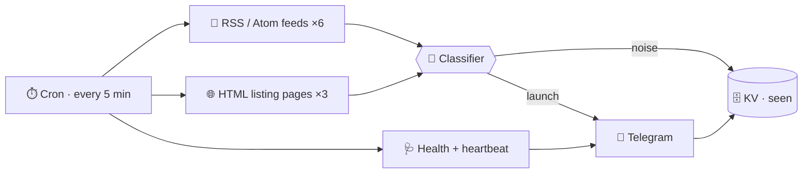

```
 █████╗ ██╗  ██████╗  █████╗ ██████╗  █████╗ ██████╗
██╔══██╗██║  ██╔══██╗ ██╔══██╗██╔══██╗ ██╔══██╗██╔══██╗
███████║██║  ██████╔╝ ███████║██║  ██║ ███████║██████╔╝
██╔══██║██║  ██╔══██╗ ██╔══██║██║  ██║ ██╔══██║██╔══██╗
██║  ██║██║  ██║  ██║ ██║  ██║██████╔╝ ██║  ██║██║  ██║
╚═╝  ╚═╝╚═╝  ╚═╝  ╚═╝ ╚═╝  ╚═╝╚═════╝  ╚═╝  ╚═╝╚═╝  ╚═╝

                ⬜🟩🟩⬜ 🟩🟩 🟩⬜🟩 ⬜🟩⬜🟩 🟩⬜ 🟩🟩
```

<div align="center">

### Know about every new AI model the moment it ships.

[](https://github.com/amiriguesss/new-ai-checker/actions/workflows/ci.yml)


</div>

---

**AI Radar** is a serverless Cloudflare Worker that polls the blogs and RSS feeds of major AI labs every 5 minutes and posts **genuine new model releases** to a Telegram chat. Blog posts about customer stories, partnerships, and policy are filtered out, so you only hear about the launches that matter.

## ✨ Features

- 🔁 **Polls every 5 minutes** via Cloudflare Cron Triggers, no servers to run
- 🧠 **Scoring classifier** that reads headlines, not keywords, to tell launches from noise
- 📡 **RSS/Atom and HTML sources** covering 9 publishers
- 🛡️ **Resilient delivery** with retries, rate-limit handling, and dead-letter protection
- 🩺 **Built-in health monitoring** with failure alerts and a daily heartbeat
- 🗄️ **Deduplication** using Workers KV with a one-year memory of seen articles
- 🚫 **No cold-start floods**: the first run only baselines existing content and sends nothing
- ✅ **Tested and CI-checked** with the Node.js built-in test runner

## 🏗️ Architecture



## 📚 Sources

| Type | Publisher |
|------|-----------|
| RSS / Atom | OpenAI · Google DeepMind · Google AI · Hugging Face · NVIDIA · AWS ML |
| HTML scrape | Anthropic · Meta AI · xAI |

The three RSS feeds from Google AI, Hugging Face, NVIDIA, and AWS ML are high-volume partner and community feeds. The classifier keeps them quiet unless a headline looks like a genuine model launch.

HTML sources are used for labs with no usable feed. The listing page is scraped for article links, and each unseen article is fetched once. Its title, date, and description come from stable metadata (`og:title` → `twitter:title` → JSON-LD `headline` → `<title>`), never from CSS class names, which change often.

## 🧠 How classification works

Each headline is scored rather than keyword-matched:

| Signal | Points |
|--------|--------|
| Release language (launch, introduces, available now…) | +2 |
| Versioned product name (e.g. `GPT-5.1`, `Gemini 2.5`) | +2 |
| Headline leads with a model name | +2 |
| Known model family | +1 |
| Model vocabulary (weights, parameters, benchmark…) | +1 |
| Case-study or corporate-news wording | penalty |

An item is announced at a score of **3 or higher**, or **2 or higher** for versioned announcements. The classifier is deliberately **title-only**, because descriptions mention models in almost every customer story.

## 🛡️ Delivery and resilience

- Messages use Telegram `parse_mode: HTML`, respect the 4096-character cap, and include a **Read more →** button.
- `429` and `5xx` responses leave the item unseen, so it is retried on the next run, and `retry_after` is honored.
- `400`, `403`, and `404` responses mark the item as seen, so one bad message can never loop forever.
- At most **3 announcements per source per run**, so a burst of posts can't flood the chat.
- Feeds use `ETag` and `If-Modified-Since`, so unchanged feeds answer `304` instead of re-downloading.

## 🗄️ State and health

| Key | Purpose |
|-----|---------|
| `state:v2:<source>` | Initialization marker and HTTP validators |
| `seen:<sha256(canonical URL)>` | Deduplication, with a 1-year TTL |
| `attempt:<…>` | Retry tracking for unparseable articles |

**Empty parses never initialize state.** A blocked fetch can't fake a baseline and flood the chat when the source recovers.

Health monitoring tracks per-source failure counters. After **3 consecutive failures**, you get a Telegram alert, with a 1-hour cooldown between alerts. A **daily heartbeat digest** doubles as a dead-man switch: if it stops arriving, the cron itself is broken.

## 🚀 Quick start

**Requirements:** Node.js 22+, a Cloudflare account, and a Telegram bot token with the target chat ID.

```bash
git clone https://github.com/amiriguesss/new-ai-checker.git
cd new-ai-checker
npm install

# Local development
cp .dev.vars.example .dev.vars   # add your bot token and chat ID

# Production secrets
npx wrangler secret put TELEGRAM_BOT_TOKEN
npx wrangler secret put TELEGRAM_CHAT_ID

npm run deploy
```

The KV namespace is already bound in `wrangler.jsonc` as `NEW_AI_CHECKER_KV`. To create your own, run `npx wrangler kv namespace create NEW_AI_CHECKER_KV` and update the `id` in the config.

## ⚙️ Configuration

| Name | Type | Description |
|------|------|-------------|
| `TELEGRAM_BOT_TOKEN` | secret | Bot token from [@BotFather](https://t.me/BotFather). Also used as the bearer token for the manual trigger. |
| `TELEGRAM_CHAT_ID` | secret | Destination chat or channel ID |
| `NEW_AI_CHECKER_KV` | binding | Workers KV namespace for state and deduplication |

## 🧪 Commands

| Command | What it does |
|---------|--------------|
| `npm run dev` | Local dev server with `--test-scheduled` enabled |
| `npm run deploy` | Deploy the Worker to Cloudflare |
| `npm test` | Run the test suite |
| `npm run typecheck` | TypeScript type check without emitting files |
| `npm run check` | Typecheck and tests together (what CI runs) |
| `npm run cf-typegen` | Regenerate Worker type definitions |

To trigger a scheduled run locally, start `npm run dev` and open `http://localhost:8787/__scheduled`.

## 📁 Project layout

```
src/
├── index.ts        # Worker entry: cron handler and manual trigger
├── config.ts       # Feeds, HTML sources, and environment typing
├── sources.ts      # Fetch, parse, dedupe, and announce pipeline
├── parse.ts        # RSS 2.0 and Atom parser
├── classifier.ts   # Headline scoring
├── telegram.ts     # Message formatting and delivery
├── health.ts       # Failure counters, alerts, and heartbeat
└── ids.ts          # Canonical URL hashing for deduplication
tests/              # Unit and pipeline tests with RSS fixtures
```

## 🧬 Testing and CI

The test suite uses Node's built-in test runner and covers the parser, classifier, ID canonicalization, Telegram delivery, the HTML source scraper, and the end-to-end pipeline. GitHub Actions runs `npm run check` on every push and pull request.

## 🤝 Contributing

Issues and pull requests are welcome. Before opening a PR, run `npm run check` and make sure it passes. New sources should come with a fixture in `tests/fixtures/` so the parser can be tested offline.

## 📄 License

Released under the terms in [LICENSE](./LICENSE).

---

<div align="center">

Made for anyone who would rather hear about the next model from a radar than from a timeline.

</div>
